# Roundkeeper

<p>
  <a href="../../releases/latest"></a>
  <a href="../../releases"></a>
  
  
  <a href="LICENSE"></a>
</p>

**A free, offline combat tracker for in-person 5e games (2024 rules).** The DM runs the fight from a laptop, the turn order lies on a tablet in the middle of the table, the TV across the room shows whose turn it is, and players follow along on their phones.

It comes with the **SRD 5.2.1** built in: 331 monsters with clickable statblocks, 339 spells, magic items, conditions and rules. No account, no subscription, no internet: it runs on your own computer, and everyone at the table connects over your Wi-Fi with a browser.

<p align="center">
  <a href="../../releases/latest"><b>⬇&nbsp;&nbsp;Download for Windows</b></a>
  &nbsp;·&nbsp; <a href="#mac-and-linux">Mac and Linux</a>
  &nbsp;·&nbsp; <a href="#getting-started">Getting started</a>
  &nbsp;·&nbsp; <a href="#faq">FAQ</a>
</p>

> **Quick start on Windows**
> 1. [Download `Roundkeeper-windows.zip`](../../releases/latest) and unzip it.
> 2. Double-click `Roundkeeper.exe`. If Windows says *"Windows protected your PC"*, click **More info → Run anyway** (the app isn't signed; GitHub builds it from this code).
> 3. Scan the QR code with the tablet, the TV and the players' phones.
>
> *Not a virtual tabletop:* there are no maps or tokens, and it isn't for online play. It's made for a group sitting around a real table.

VIDEO_FOUR

<p align="center"><sub>One fight on all four screens at once: the DM's laptop, the tablet, the TV and a phone (50 seconds, no sound).</sub></p>

**Three short tours, under a minute each:** [the DM's laptop](#the-dms-laptop) · [the tablet and the TV](#the-tablet-and-the-tv) · [the players' phones](#on-players-phones)

---

## One fight, four screens

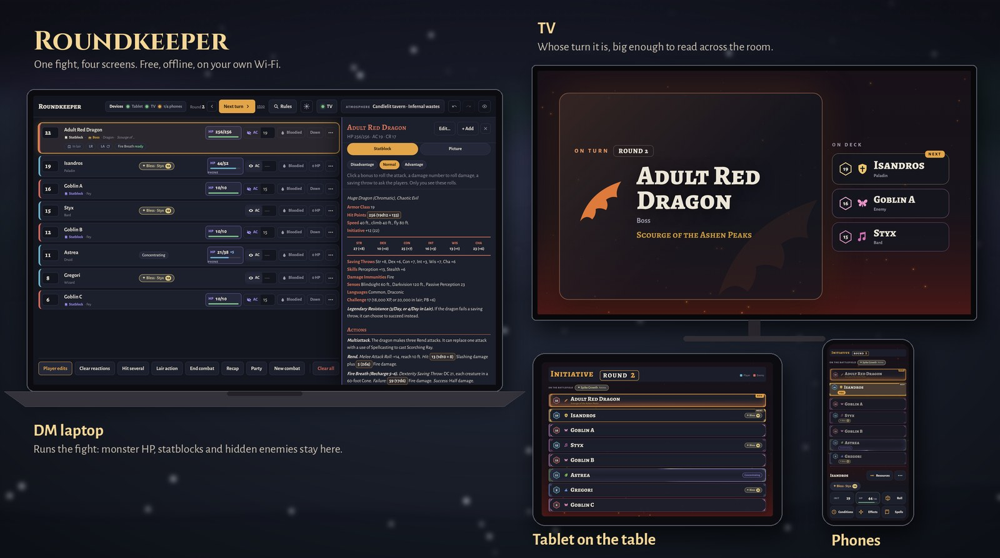

Each screen shows what its people need, and only that. Monster HP, statblocks, hidden enemies and secret countdowns never leave the DM's laptop. Use any of the four: a laptop and a tablet are enough.

---

## The DM's laptop

VIDEO_DM

<p align="center"><sub>From the DM's seat: monsters from the built-in SRD, the statblock, a roll call, Hit several, conditions, Ctrl+K, Devices and Atmosphere (under a minute, no sound).</sub></p>

- **Initiative and turns:** add players and monsters, roll or type initiative, step through turns and rounds. Undo is always there.
- **Statblocks you click:** an attack bonus rolls the attack, a damage number rolls damage, a save sends a roll call to the players it targets. Recharge, X/Day and Legendary actions are tracked as you use them.
- **Monster HP that only you see:** damage, healing, temp HP and a history you can undo one entry at a time. Bloodied and Down stay your call.
- **Hit several:** one Fireball or breath weapon on several targets, with saves rolled from each statblock, resistances applied, and players asked on their phones.
- **Conditions and spells with their 2024 durations**, ending by themselves at the right turn; Concentration saves worked out for you.
- **Devices:** one window with the QR code, every screen and phone, whether it's connected, and its full address.

<details>
<summary><b>More for the DM</b></summary>

- **Rules lookup (Ctrl+K):** spells, conditions, rules and items, with cards you can pin or show on the table.
- **Lair actions, countdowns** ("the ritual completes in 3 rounds"), **ongoing damage** (Heat Metal, poison) and **monster groups** that players see as one row.
- **Players' character sheets:** open a player's sheet like a statblock, with clickable bonuses and their prepared spells. Fill in or paste a sheet yourself and send it to their phone, or keep it only for you for a player on paper.
- **Players' HP from their phones** shows in their rows (only you see it).
- **Party numbers:** AC, passive Perception, Insight and Investigation and spell DCs in one table.
- **Boss tools:** preview the reveal before you show it, give a boss a title and its own background.
- **Summons and familiars** that follow their owner's turn, with HP the player can see.
- **Recap:** a summary of the fight with defeats, damage, nat 20s and nat 1s and turn times, saved as a document for your notes.
- **A desktop as the server, the laptop as the DM:** pair any device as a DM screen.
- **Your own homebrew:** paste or drop statblocks, or import a JSON file.

</details>

<table>
<tr>
<td width="50%">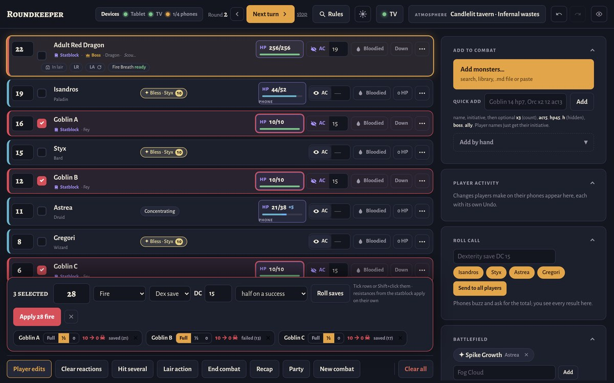<br><sub><b>Hit several:</b> 28 fire on three goblins; two saved for half.</sub></td>
<td width="50%">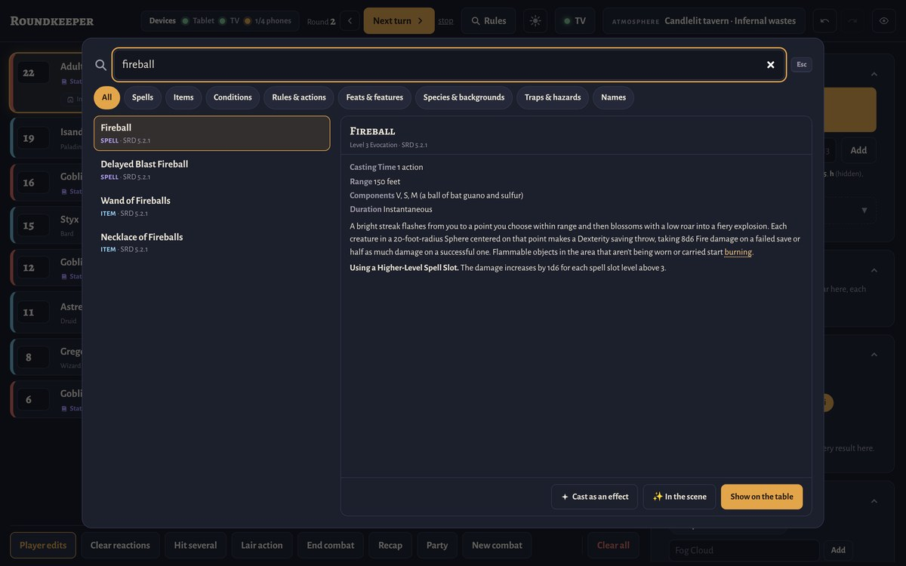<br><sub><b>Ctrl+K:</b> any spell, condition, rule or item, and "Show on the table".</sub></td>
</tr>
<tr>
<td width="50%">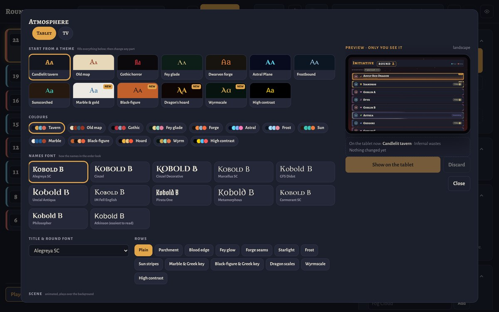<br><sub><b>Atmosphere:</b> build the table's look with a live preview before it changes.</sub></td>
<td width="50%">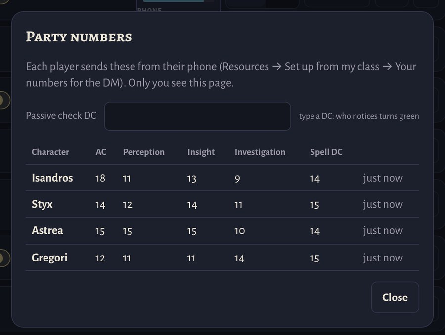<br><sub><b>Party numbers:</b> passives at a glance; a passive check marks who notices.</sub></td>
</tr>
</table>

---

## The tablet and the TV

VIDEO_TABLE

<p align="center"><sub>What the players see: the tablet on the table and the TV across the room, side by side through one fight (under a minute, no sound).</sub></p>

### On the table

<table>
<tr>
<td width="42%" valign="top">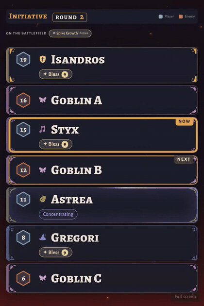</td>
<td valign="top">

- The turn order, big and readable from every seat, in portrait or landscape. Even with many conditions on screen, labels stay whole words.
- **Boss intros:** reveal a hidden enemy and its name and title fill the screen. When a boss falls, the player who landed the blow gets *"How do you want to do this?"*
- **Roll calls:** "Dexterity save DC 21" shows a tile for each player as they answer.
- **Conditions with their own animation:** stone for Petrified, chains for Restrained.
- **The scene reacts:** Fireball explodes over the order, Cone of Cold frosts the edges, Fog Cloud and Darkness stay while they last, Bless sends a golden wave from the caster. A nat 20 flashes, a lair action rumbles, the colour drains when a player drops to 0 HP.
- Players see only what you show: hidden enemies and monster HP never reach it.

</td>
</tr>
</table>

<table>
<tr>
<td width="33%">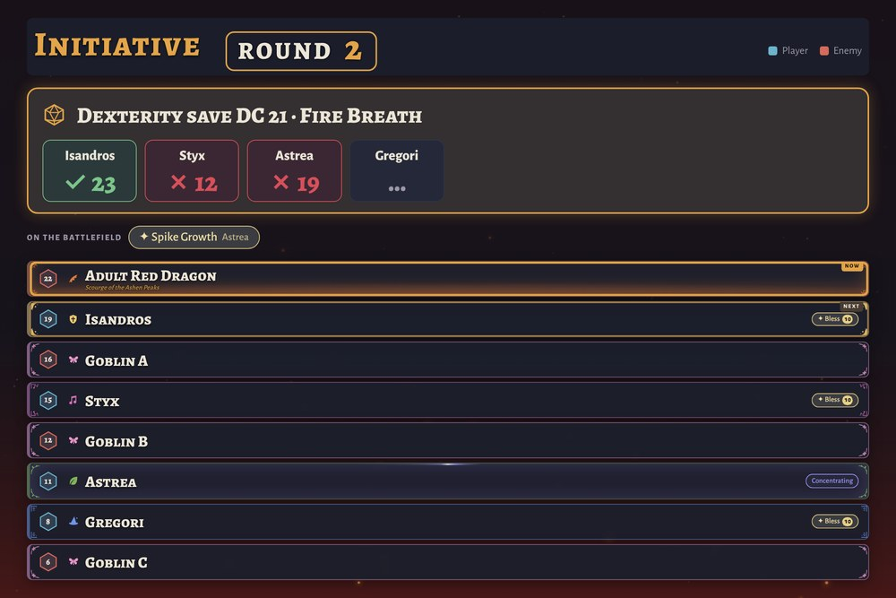<br><sub>A roll call for the dragon's breath.</sub></td>
<td width="33%">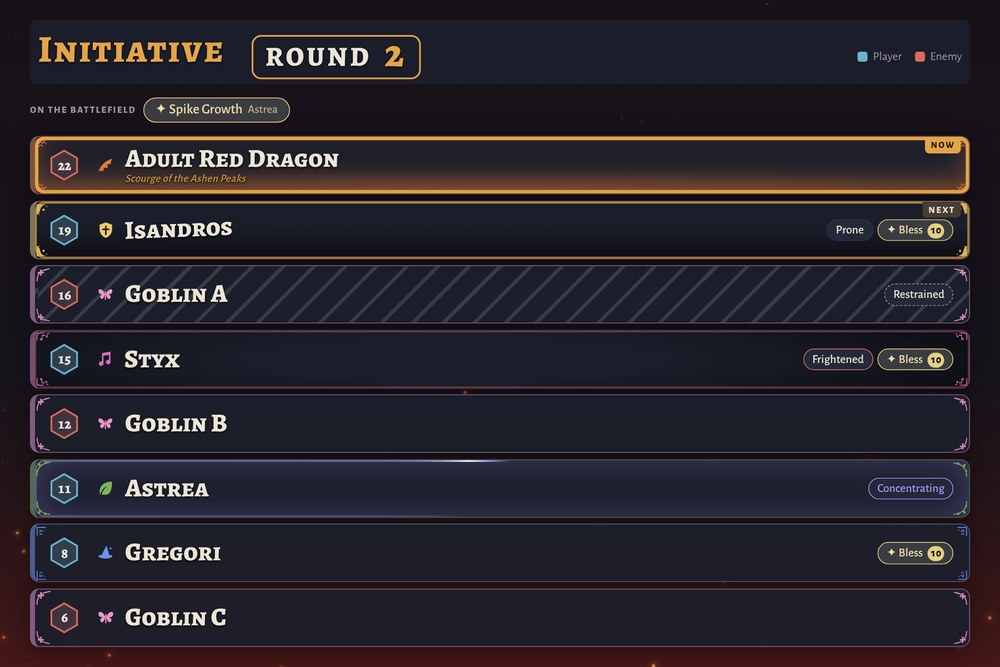<br><sub>Conditions on the rows.</sub></td>
<td width="33%">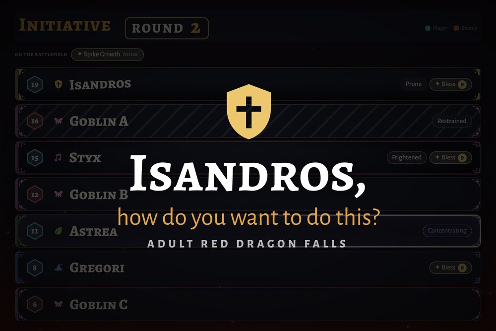<br><sub>The dragon falls.</sub></td>
</tr>
</table>

### On a TV

One big thing at a time, readable from across the room. In **Auto** the TV follows the fight by itself:

- **Before the fight:** your scene or picture (it drifts and zooms slowly), title cards for locations and chapters, and a **break timer** ("we continue at 21:40").
- **Roll for initiative:** each player's number arrives as a card, and it shows who hasn't rolled yet.
- **Spotlight:** whose turn it is, huge, with who's up next. **Order:** the whole initiative as cards.
- **Roll calls as cards** that flip as players answer, with the DC and "3 of 4 succeeded".
- **Its own dice:** a shared roll lands big on the TV; a nat 20 or nat 1 stays longer.
- **Death saves:** on a downed player's turn, a heartbeat and three plus three boxes.
- **Each new round:** what happened last round, then the countdown as a big ring.
- **End of the fight:** victory, the MVP, the biggest hit, the luckiest roll, the final blow and the XP. Hidden creatures are never named.
- Its own look (theme, colours, fonts, scene) with a live preview, and a Light mode for a slow TV browser. You choose which big moments show on the tablet, on the TV, or on both.

<table>
<tr>
<td width="50%">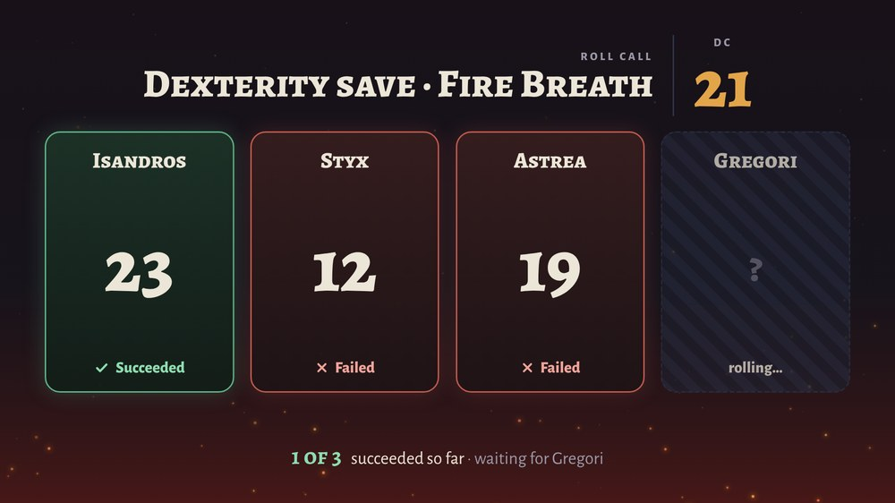<br><sub>A roll call on the TV.</sub></td>
<td width="50%">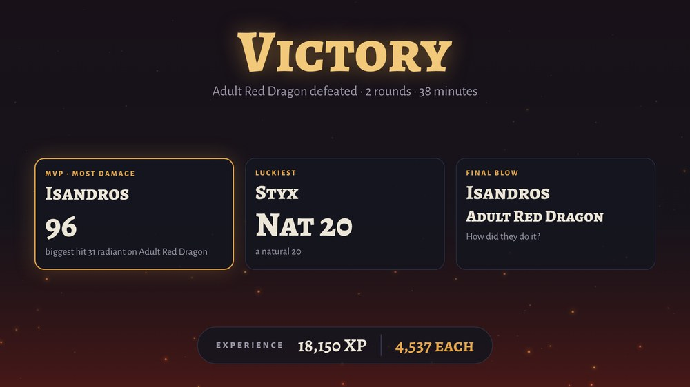<br><sub>The end of the fight.</sub></td>
</tr>
<tr>
<td width="50%"><br><sub>A title card.</sub></td>
<td width="50%">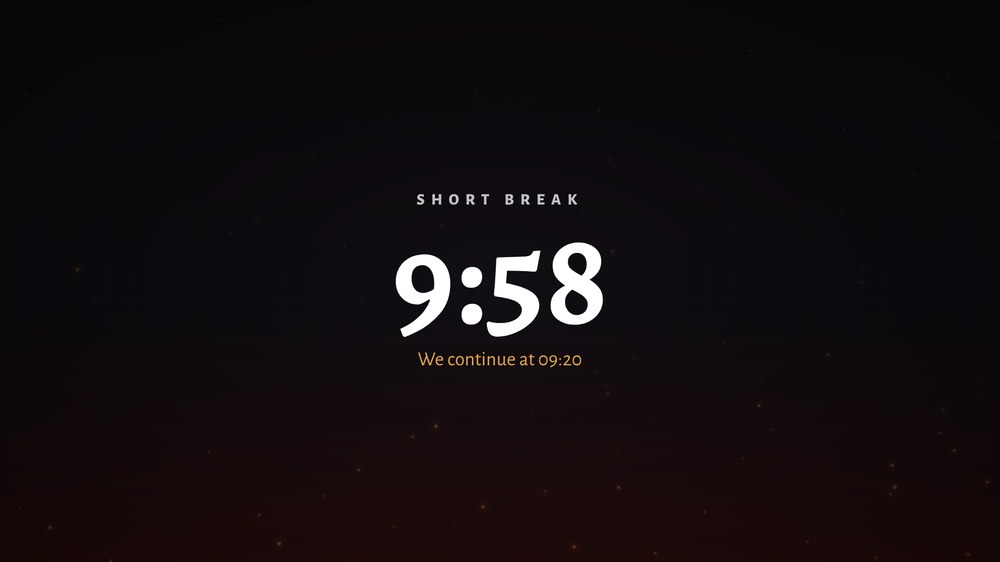<br><sub>A short break, counting down.</sub></td>
</tr>
</table>

### 13 themes and 35 animated scenes

<p align="center">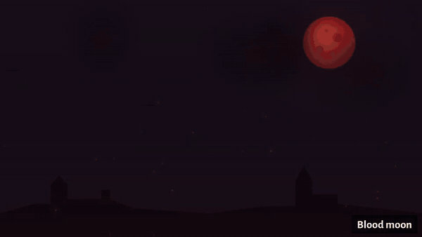</p>

Pick a theme, then change any part of it: colours, fonts, row style, an animated scene or your own background picture. Put **rain, snow, fog or ash** over any scene or picture, set the **time of day** (dawn, day, dusk, night), and make each scene calmer or wilder. Save the look as your own theme.

---

## On players' phones

VIDEO_PHONE

<p align="center"><sub>A player's phone with the tablet beside it: joining, initiative, a spell on the table, resources, the sheet, a roll call, Concentration and death saves (under a minute, no sound).</sub></p>

<table>
<tr>
<td width="30%" valign="top">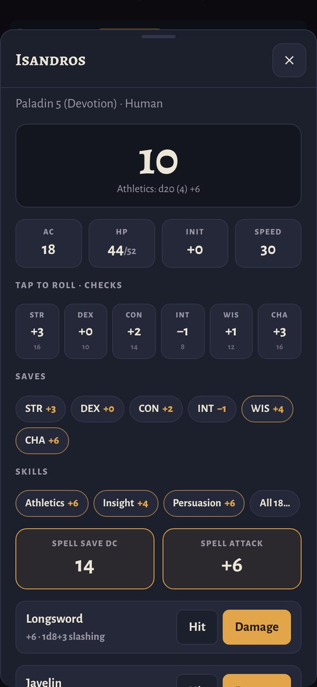</td>
<td valign="top">

- Join by scanning a QR code. Nothing to install.
- **Their own HP**, temp HP and death saves, with big buttons and the app's own keypad.
- **Character sheet (optional):** fill it in step by step or paste the text of an existing sheet. Checks, saves, skills and attacks roll with the real bonuses, and a roll call offers "Roll Dex save +2".
- **Spellbook** with full spell cards and prepared spells, including the ones a subclass always prepares. "Show it on the table" plays a spell in the tablet's scene.
- **Spell slots and class resources** (Rage, Focus, Channel Divinity…) as circles: tap a full one to use it, an empty one to get it back. Short and long rests reset them.
- They answer your **roll calls** and **Concentration saves**, give Bardic Inspiration to a friend, and run their familiar or summon.
- **Simple mode** for players who keep the rest on paper: just their HP, plus whatever you send them.

</td>
</tr>
</table>

<table>
<tr>
<td width="25%">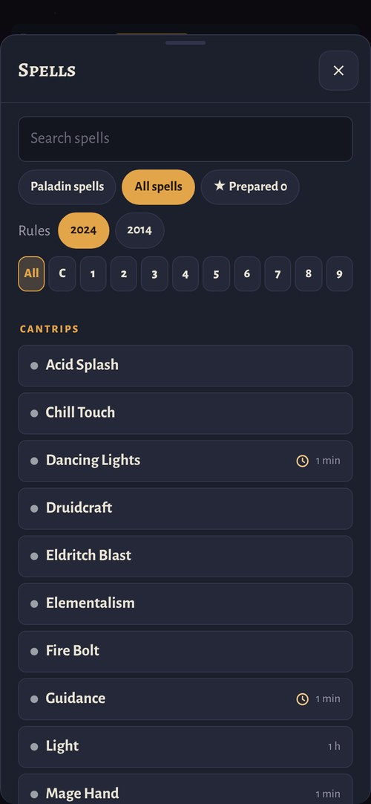<br><sub>Spells by level.</sub></td>
<td width="25%">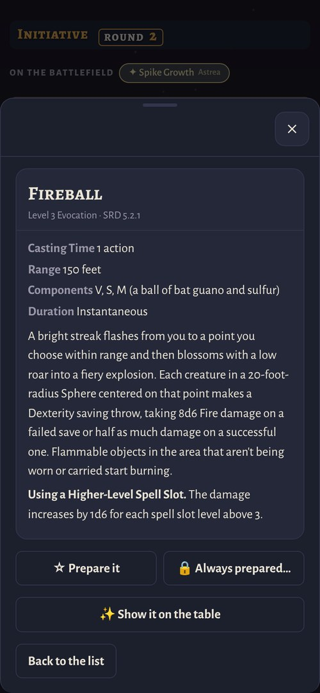<br><sub>A full spell card.</sub></td>
<td width="25%">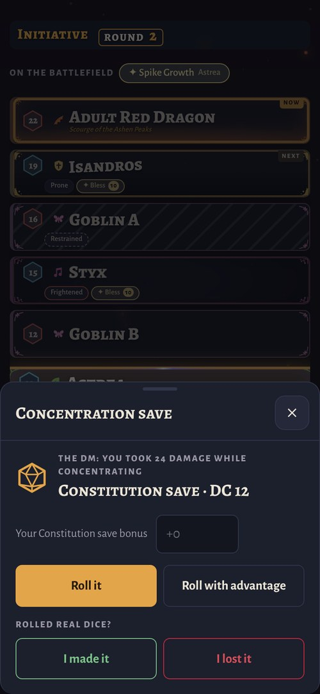<br><sub>A Concentration save.</sub></td>
<td width="25%">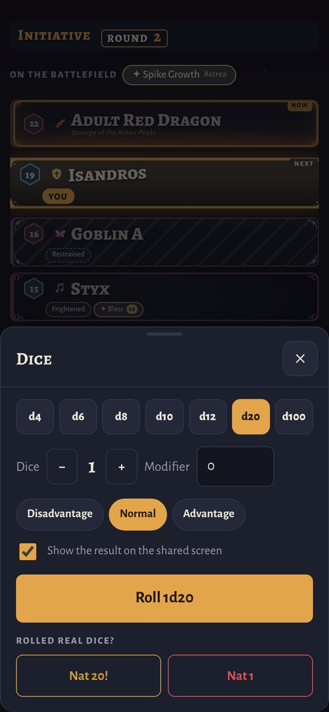<br><sub>Dice, shared on the table if they like.</sub></td>
</tr>
</table>

---

## Getting started

### Windows
1. Download `Roundkeeper-windows.zip` from [Releases](../../releases) and unzip it anywhere.
2. Double-click `Roundkeeper.exe`. Your browser opens the DM screen.
3. Click **Devices**: it shows a QR code for the players and the full address for the tablet and the TV. Scan the code or type the address, then pick **This is the tablet**, **This is the TV**, or your character.

Windows may say *"Windows protected your PC"* because the app isn't signed. Click **More info → Run anyway**. The exe is built by GitHub from the code in this repository; see [`.github/workflows`](.github/workflows).

<p align="center">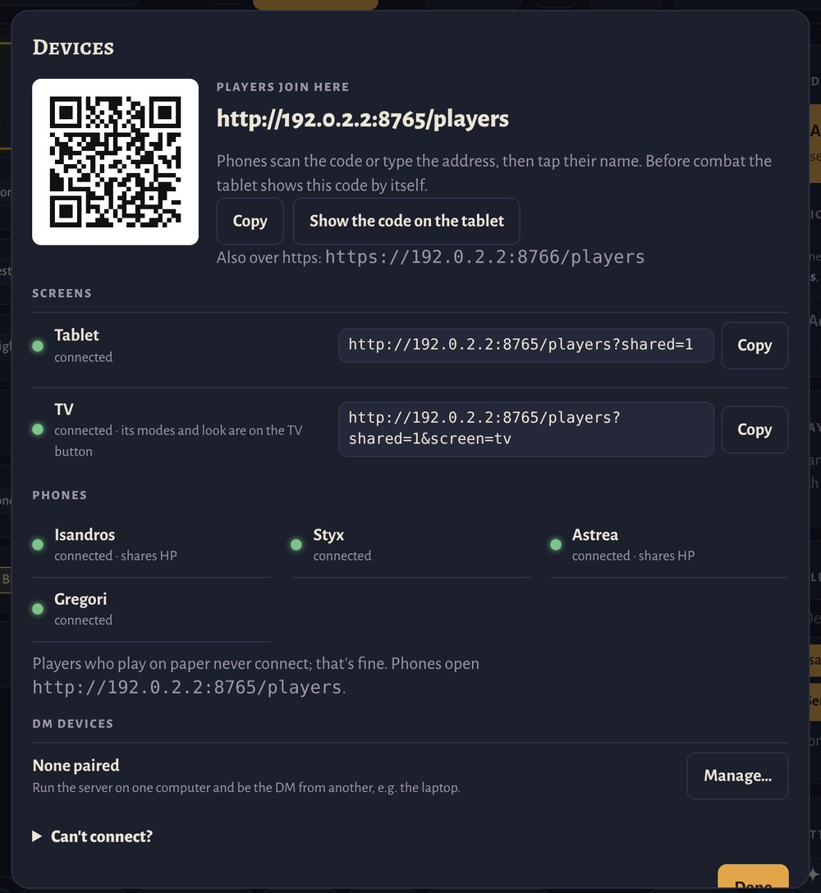<br><sub><b>Devices:</b> who is connected, and where each screen goes.</sub></p>

### Mac and Linux
You need Python 3 (no extra packages).

```
python3 server.py
```

Then open the address it prints.

### Server on a desktop, DM on a laptop
Run the app on a desktop (on a cable, or connected to the TV), then pair your laptop as the DM under **Devices → DM devices**. Phones stay players.

### If someone can't connect
**Devices → Can't connect?** in the app has the same list.
- Everyone must be on the same Wi-Fi.
- On Windows, allow the app through the firewall when asked (private networks).
- Guest networks often block devices from seeing each other.

---

## Game data

- **The SRD 5.2.1 is built in:** 331 monsters with clickable statblocks, 339 spells with full text (on players' phones too), magic items, conditions and rules, ready in the monster search and in Ctrl+K from the first start.
- **Statblocks:** paste or drop a monster's statblock (text or .md) and its attacks, damage and saves become clickable. It's kept in your library for next time.
- **Import your homebrew:** Settings → Game data → **Import a JSON file** adds one homebrew file (monsters, spells, items, conditions or rules in the common community format). Remove it there again.
- **Bring more (optional):** put more JSON data in a folder named `5etools` next to the app and it's read the same way. Anything your files also have is shown from your files, so nothing appears twice.
- **Nothing is downloaded.** The app only reads files that are already on your computer. Monster pictures are ones you add yourself.

---

## FAQ

**Is it free?** Yes, completely, and the code is open source ([AGPL-3.0](LICENSE)). No accounts, no subscriptions, no ads.

**Can I change it or share it?** Yes. You can use, change and share it, as long as what you share stays open under the same license, with its source. See [License and credits](#license-and-credits).

**Does it need the internet?** No. The laptop (or desktop) runs it, and the tablet, TV and phones connect to it over your own Wi-Fi.

**What do the players need?** A phone with a browser. They scan a QR code and pick their character; nothing to install. Players who prefer paper don't need anything, and nothing waits for them.

**Do I need a tablet and a TV?** No. A laptop and one shared screen (a tablet, a second monitor or the TV) is the usual setup. Use whatever you have.

**Does it come with monsters and spells?** Yes, the SRD 5.2.1: 331 monsters, 339 spells, magic items, conditions and rules. You can add your own homebrew as JSON, and paste or drop statblocks.

**Which rules?** Fifth edition as revised in 2024 (conditions, durations, Concentration, death saves, Exhaustion). Players can switch their spell list to the 2014 versions when your files have them.

**Mac or Linux?** Yes, with Python 3 (`python3 server.py`). The ready-made program is for Windows 10 and 11.

**Can I use it online, with players at home?** It's made for a table in one room, on one Wi-Fi network.

---

## Privacy and safety

- Everything runs on your computer. There are no accounts, analytics or cloud services.
- Your fights, library and settings are plain files in the app's folder, and backups are made automatically.
- **Made for your home Wi-Fi.** Player pages have no password, so don't run it on public networks (cafés, conventions).
- Only the DM's devices can change the fight. Phones see only what players are allowed to see.

---

## How it was made

I designed this for my own table, decided how every part should work, and tested it in real sessions. The code was written with an AI assistant (Claude). There is **no AI-generated art** in it: the scenes, icons and animations are drawn in code, and the fonts are open-licensed. The full source is here, so you can see exactly what it does.

---

## Feedback

Found a bug or have an idea? [Open an issue](../../issues). It helps to say how your table is set up: which screens you use, and whether your players use phones or paper.

Pull requests are welcome. By opening one, you agree that your contribution is licensed under the AGPL-3.0 (or later) like the rest of the code, and that the maintainer may also license it under other terms.

---

## License and credits

- **Code:** Copyright (C) 2026 swampcore-beep, licensed under the [GNU Affero General Public License v3.0](LICENSE) or (at your option) any later version. You may use, study, change and share it; if you share a changed version, or let other people use one over a network, it must stay under the same license and come with its source. Third-party code (the QR code generator, MIT) keeps its own license; see [`THIRD-PARTY-NOTICES.txt`](THIRD-PARTY-NOTICES.txt).
- **Game content:** The built-in game data is converted from [Open5e](https://github.com/open5e/open5e-api)'s transcription of the SRD (see [`tools/srd_from_open5e.py`](tools/srd_from_open5e.py)). This work includes material from the System Reference Document 5.2.1 ("SRD 5.2.1") by Wizards of the Coast LLC, available at https://www.dndbeyond.com/srd. The SRD 5.2.1 is licensed under the Creative Commons Attribution 4.0 International License, available at https://creativecommons.org/licenses/by/4.0/legalcode.
- **Fonts:** Alegreya, Alegreya Sans, Atkinson Hyperlegible, Cinzel, Cinzel Decorative, Cormorant, GFS Didot, IM Fell English, Marcellus, Metamorphous, Philosopher, Pirata One and Uncial Antiqua, under the SIL Open Font License; see [`fonts/`](fonts).
- This is an unofficial fan tool. It is not affiliated with or endorsed by Wizards of the Coast. Dungeons & Dragons is a trademark of Wizards of the Coast LLC.
