

  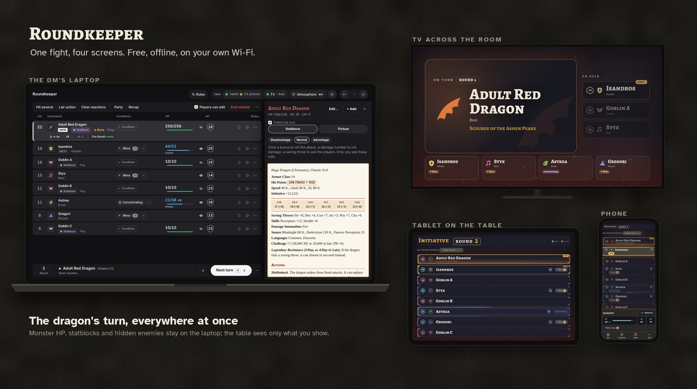

  <b>A free, offline combat tracker for 5e games around a real table (2024 rules).</b> 
  The DM runs the fight from a laptop. The tablet on the table, the TV across the room and the players' phones follow along over your Wi-Fi.

  
  
  
  

  <a href="../../releases/latest"><b>⬇&nbsp;&nbsp;Download for Windows</b></a>
  &nbsp;·&nbsp; <a href="#mac">Mac</a>
  &nbsp;·&nbsp; <a href="#linux">Linux</a>
  &nbsp;·&nbsp; <a href="#getting-started">Getting started</a>
  &nbsp;·&nbsp; <a href="#faq">FAQ</a>

https://github.com/user-attachments/assets/5c44bd7f-69f3-4e3c-bbb6-5dcdeb8b5bc0

One fight from start to finish: all four screens, then the DM's laptop, a player's phone, and the tablet and the TV (2½ minutes, no sound).

<table>
<tr>
<td width="50%" valign="top"><b>Made for the table</b> Not a virtual tabletop: no maps, no tokens, no online play. It keeps the fight moving for a group sitting in one room.</td>
<td width="50%" valign="top"><b>Free, offline, nothing to install on phones</b> It runs on your own computer. Everyone else scans a QR code and opens it in a browser. No accounts, no subscription.</td>
</tr>
<tr>
<td valign="top"><b>The SRD 5.2.1 built in</b> 331 monsters with statblocks you click to roll, 339 spells, magic items, conditions and rules, from the first start.</td>
<td valign="top"><b>Every screen has a job</b> The laptop runs the fight, the tablet shows the order, the TV the big moments, each phone its own character. Monster HP and hidden enemies stay on the laptop.</td>
</tr>
</table>

> **New in 1.8:** items and coins. The DM hands out loot, and players carry, use, spend and give it on their phones. **Earlier:** 3D dice (1.6) and a real character sheet with feats (1.5). [What's changed](../../releases)

---

## The DM's laptop

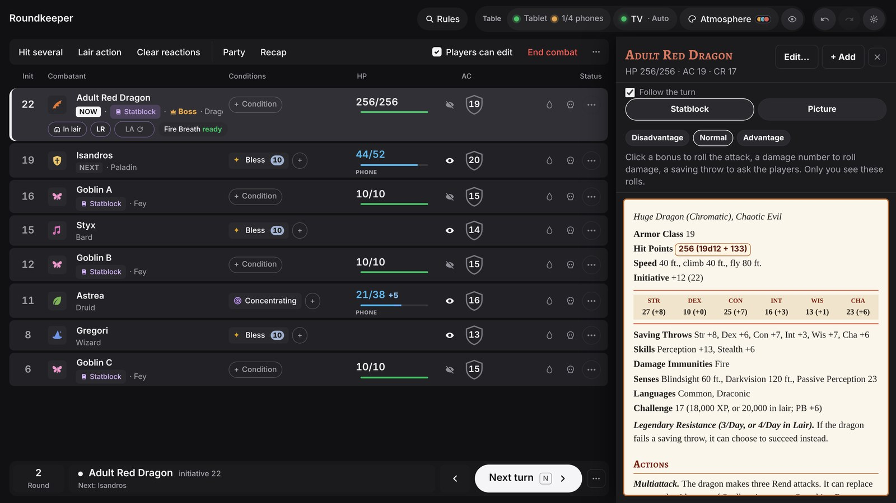

The turn order is one row per creature, and the statblock opens beside it, so you never lose your place.

- **Initiative and turns:** add players and monsters, roll or type initiative, step through turns and rounds. Undo is always there.
- **Statblocks you click:** the attack bonus rolls the attack, the damage rolls damage, and a save asks the players it targets on their phones. Recharge, X/Day and Legendary actions keep count.
- **Monster HP only you see:** damage, healing and temp HP, with a history you can undo. Bloodied and Down stay your call.
- **Hit several:** one Fireball on many targets, with every save rolled and resistances worked out.
- **Conditions and spells with their 2024 durations:** they end by themselves at the right turn, and Concentration saves are asked for you.
- **Rules lookup (Ctrl+K):** any spell, condition, rule or item, and a card you can show the table.

<table>
<tr>
<td width="50%">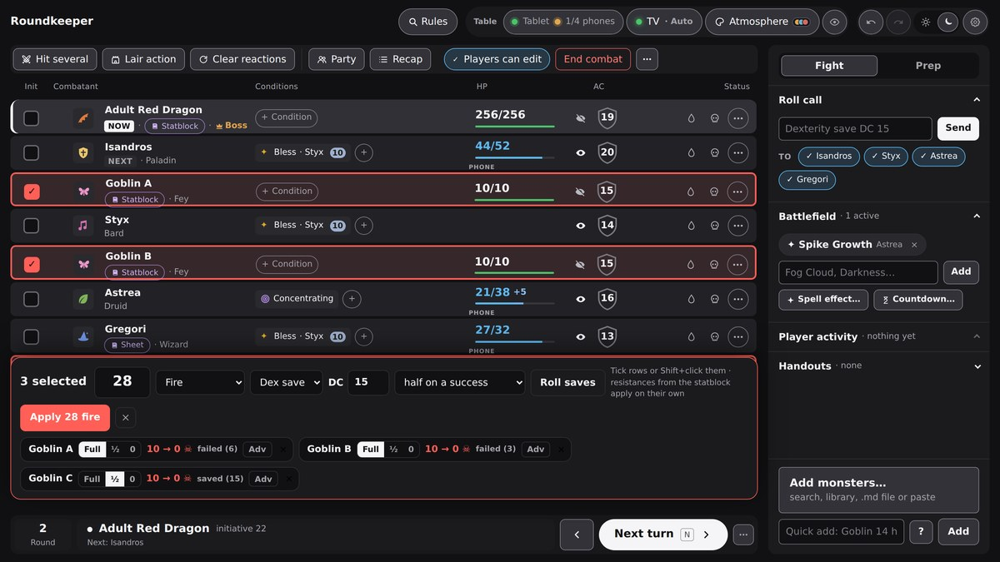 <b>Hit several:</b> 28 fire on three goblins, each Dexterity save rolled, half on a success.</td>
<td width="50%">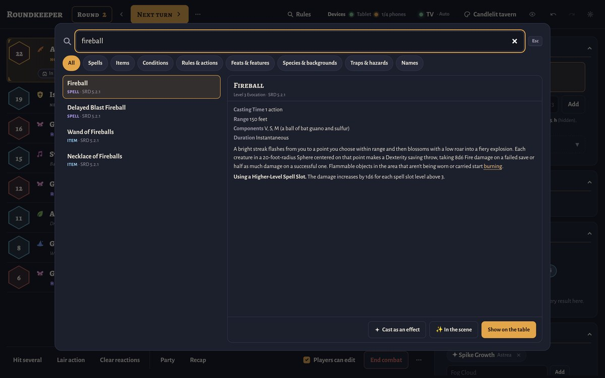 <b>Ctrl+K:</b> any spell, condition, rule or item.</td>
</tr>
<tr>
<td width="50%">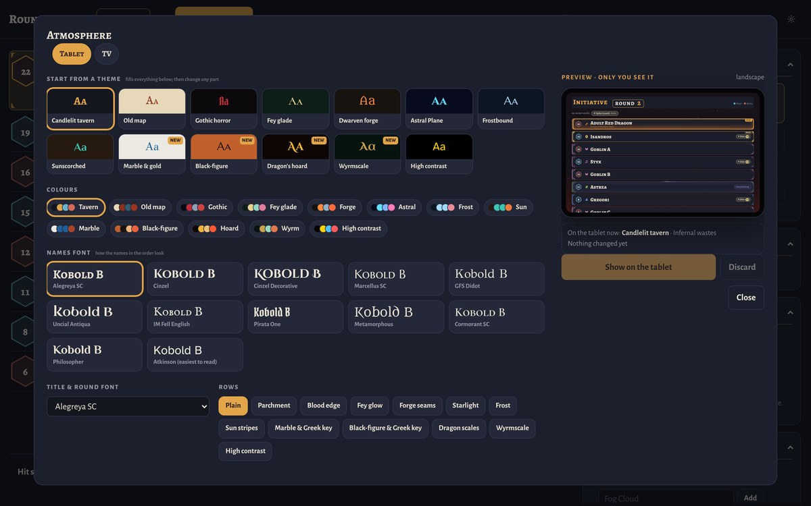 <b>Atmosphere:</b> the table's look, with a preview before it changes.</td>
<td width="50%">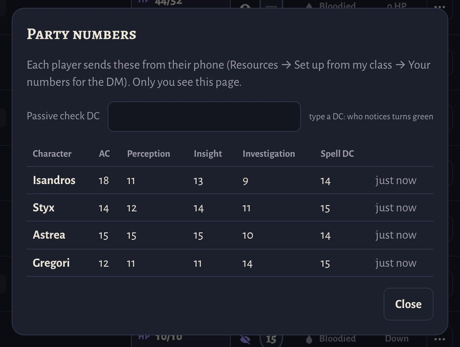 <b>Party numbers:</b> AC, passives and spell DCs at a glance.</td>
</tr>
</table>

<table>
<tr>
<td width="38%" valign="top">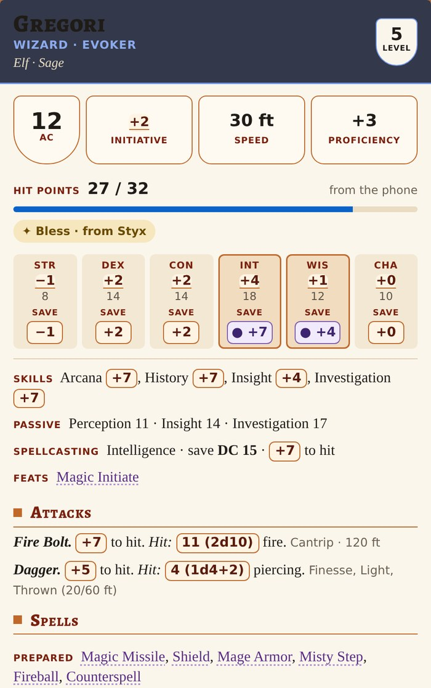</td>
<td valign="top">

**Your players' sheets, one click away.** Open a player like a monster and their sheet appears as a card: AC, HP from their phone, abilities, saves, skills, feats, attacks and prepared spells. Every bonus rolls. A player fills it in on their phone, or you set it up for them and send it over. For a player on paper, keep it just for yourself.

<b>More for the DM</b>

- **Handouts:** notices, sealed letters, wanted posters or lore, shown on the tablet, the TV or the phones.
- **Lair actions, countdowns** ("the ritual completes in 3 rounds"), **ongoing damage** and **monster groups** that players see as one row.
- **Boss tools:** preview the reveal, give a boss a title, its own background and phases.
- **Summons and familiars** that follow their owner's turn.
- **Recap:** the fight's defeats, damage, natural 20s and 1s and turn times, saved for your notes.
- **Devices:** the QR code and every connected screen and phone in one window.
- **Light screen** for a bright room, and a narrow window turns the side panel into a drawer.
- **Items and coins:** give items and gold from the SRD, your data files or your own, keep the party's loot, and see what each player carries.
- **Your own homebrew:** paste or drop statblocks, or import a JSON file.

</td>
</tr>
</table>

---

## The tablet and the TV

<table>
<tr>
<td width="50%">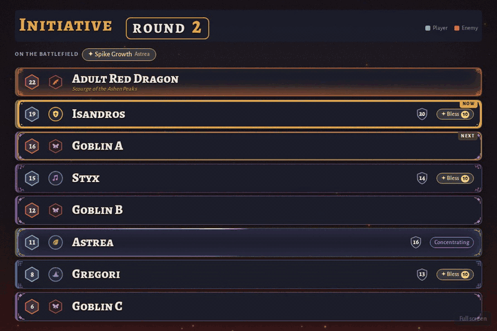 <b>On the table:</b> the turn moves, a goblin is Bloodied, a natural 20.</td>
<td width="50%">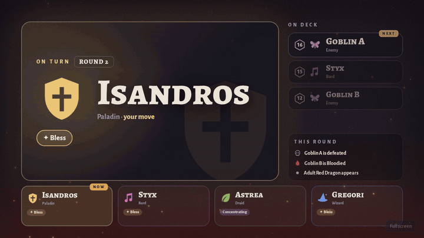 <b>On the TV:</b> whose turn it is, who's next, and the round so far.</td>
</tr>
</table>

<table>
<tr>
<td width="42%" valign="top">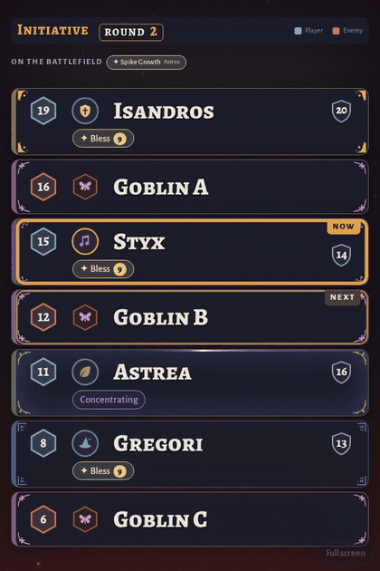</td>
<td valign="top">

**On the table**, the turn order is big enough to read from every seat.

- **Boss intros:** reveal a hidden enemy and its name fills the screen. When it falls, the player who landed the blow gets *"How do you want to do this?"*
- **Roll calls:** "Dexterity save DC 21", with a tile for each player as they answer.
- **Conditions with their own look:** stone for Petrified, chains for Restrained.
- **The scene reacts:** Fireball explodes over the order, Fog Cloud stays while it lasts, a natural 20 flashes.

</td>
</tr>
</table>

<table>
<tr>
<td width="33%">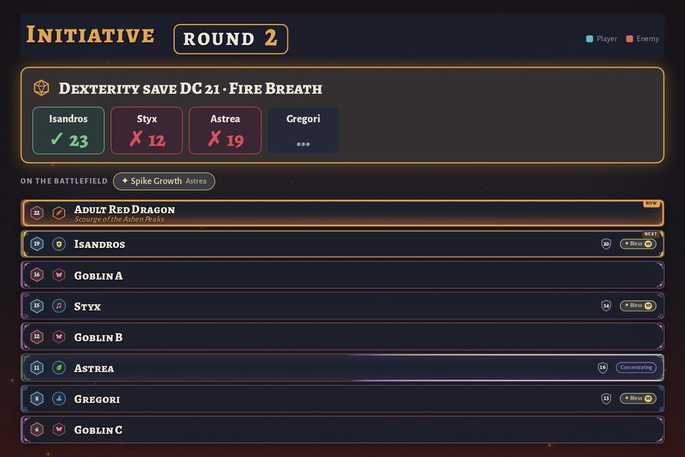 A roll call for the dragon's breath.</td>
<td width="33%">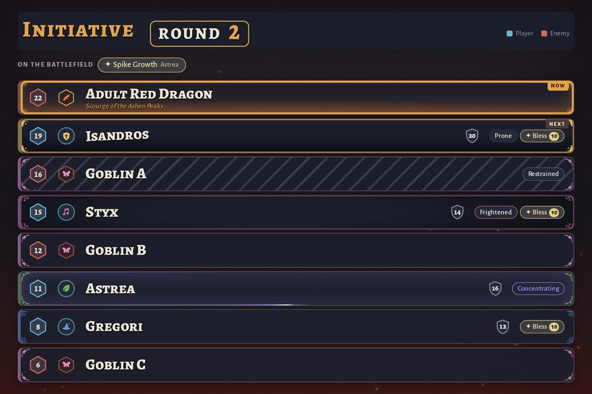 Conditions on the rows.</td>
<td width="33%">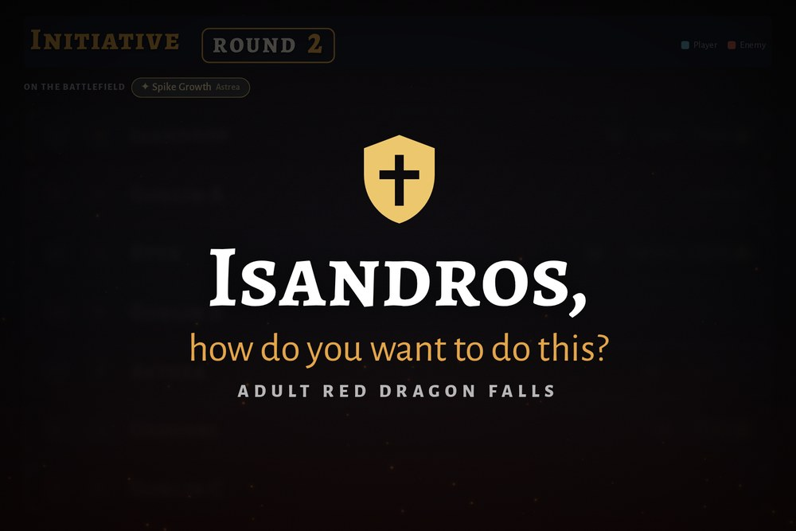 The dragon falls.</td>
</tr>
</table>

**On the TV**, one big thing at a time. In Auto it follows the fight by itself:

- **Before the fight:** your scene, title cards for places and chapters, and a break timer.
- **During it:** whose turn it is in a spotlight, who's next, and the party along the bottom. Roll calls arrive as cards, and shared rolls as 3D dice, flat dice or just the number.
- **The big moments:** a heartbeat and death saves when a player is down, a recap at each new round, and at the end the MVP, the biggest hit and the XP.

<table>
<tr>
<td width="50%">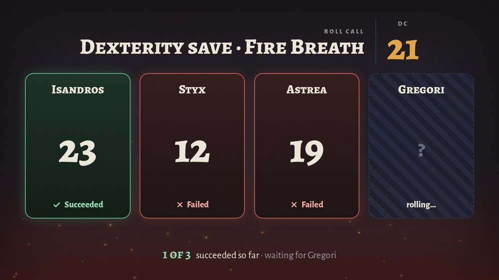 A roll call on the TV.</td>
<td width="50%">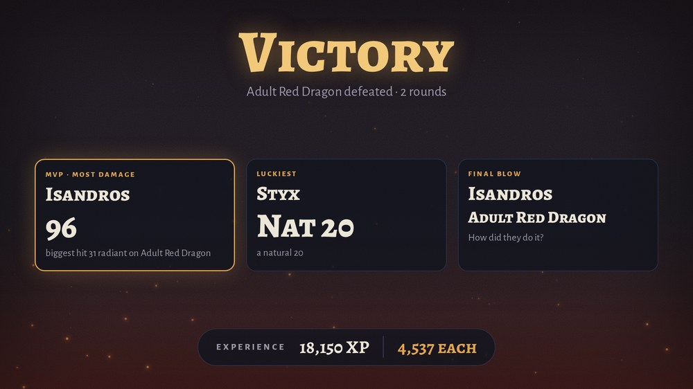 The end of the fight.</td>
</tr>
</table>

### 13 themes and 35 animated scenes

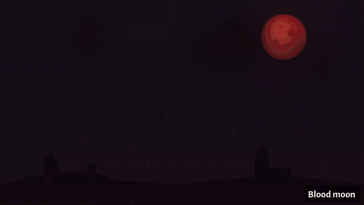

Pick a theme and change any part of it: colours, fonts, an animated scene or your own picture, with rain, snow, fog or ash and the time of day on top. Save it as your own.

---

## On the players' phones

<table>
<tr>
<td width="30%" valign="top">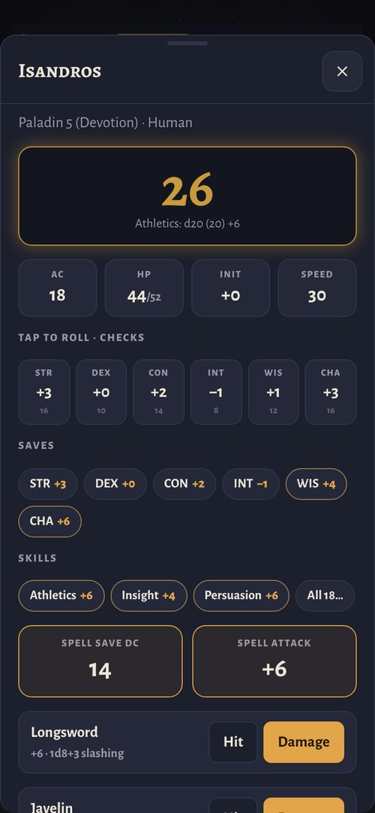</td>
<td valign="top">

Players scan a QR code and tap their character. Nothing to install.

- **Their character sheet:** Main, Spells and Features, with sections that open when needed. Checks, saves and attacks roll with the right bonus. Fill it in step by step, or paste an existing sheet.
- **Feats:** pick them from your data files and the sheet counts what they change (Alert, Tough and the like).
- **HP and death saves**, with big buttons and the app's own keypad.
- **Your turn:** what's on them in plain words, who cast it, and their reaction.
- **Spellbook** with full spell cards, and spell slots and class resources as boxes to tap.
- **Items and coins:** drink a potion, attack with a weapon, use a wand's charges, spend or give coins, and take a share of the party's loot.
- **Roll calls and Concentration saves** with one tap, Bless and Bane added by themselves, and **dice** they can share with the table.
- **Simple mode** for players who keep the rest on paper: just their HP.

</td>
</tr>
</table>

<table>
<tr>
<td width="25%">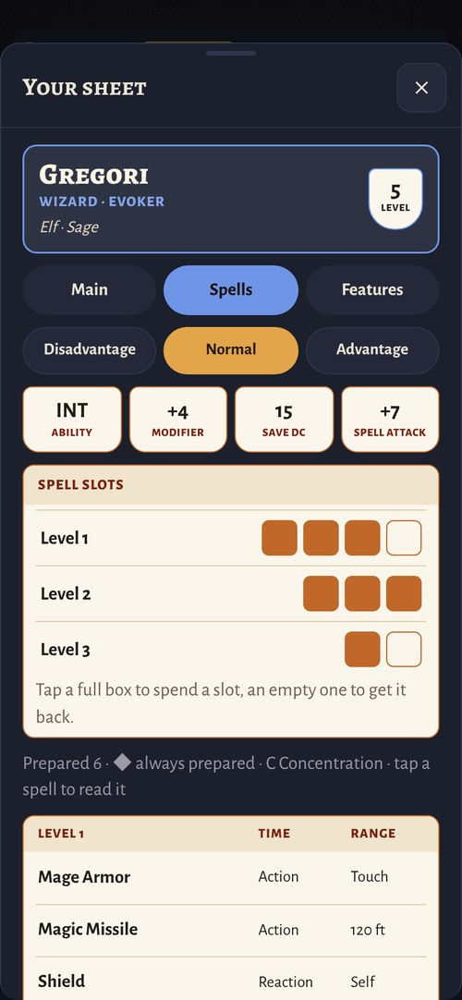 Spells: slots, time and range.</td>
<td width="25%">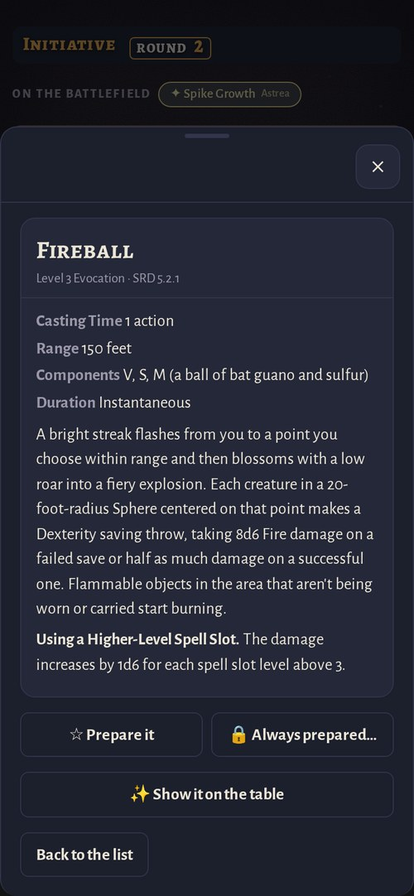 A full spell card.</td>
<td width="25%">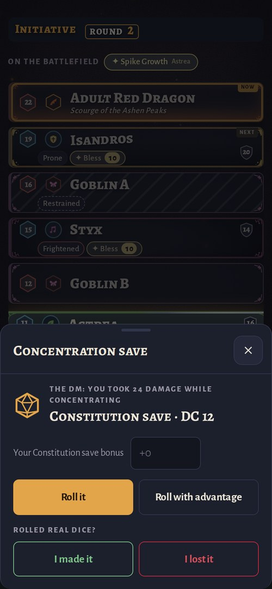 A Concentration save.</td>
<td width="25%">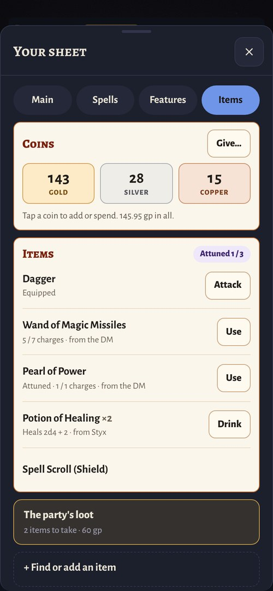 Items, coins and the party's loot.</td>
</tr>
</table>

---

## Getting started

### Windows
1. [Download `Roundkeeper-windows.zip`](../../releases/latest) and unzip it anywhere.
2. Double-click `Roundkeeper.exe`. Your browser opens the DM screen. If Windows says *"Windows protected your PC"*, click **More info → Run anyway**: the app isn't signed, and GitHub builds it from the code here ([`.github/workflows`](.github/workflows)).
3. Click **Devices** and scan the QR code with the tablet, the TV and the phones. Each one picks **This is the tablet**, **This is the TV**, or a character.

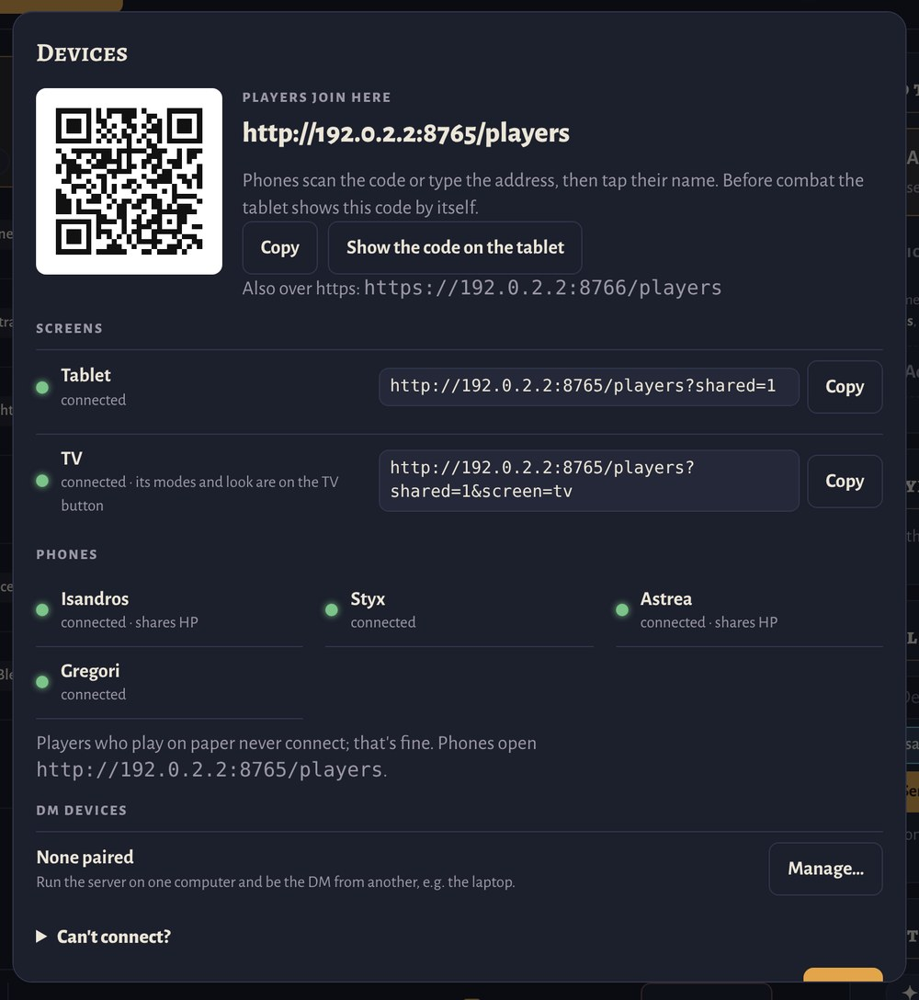 <b>Devices:</b> who is connected, and where each screen goes.

### Mac
1. [Download `Roundkeeper-mac.zip`](../../releases/latest) and unzip it into a normal folder, such as `Documents/Roundkeeper`. One program runs on Intel and Apple Silicon.
2. Double-click `Roundkeeper`. A Terminal window keeps the server running, and your browser opens the DM screen.
3. The first time, the Mac can't check the developer. Click **Done**, then **System Settings → Privacy & Security → Open Anyway**. Allow incoming network connections when asked.

I haven't tested it on many Macs yet. If it doesn't start, please [open an issue](../../issues).

### Linux
[Download `Roundkeeper-linux.zip`](../../releases/latest), unzip it, and run `./roundkeeper` (`./roundkeeper-arm64` on a Raspberry Pi). Then open the address it prints.

### Good to know
- **Updating:** **Settings and files → Updates** checks for a new version. Replace the program; your fights, library and pictures stay.
- **Server on a desktop, DM on a laptop:** run it on the desktop and pair your laptop under **Devices → DM devices**.
- **Can't connect?** Everyone must be on the same Wi-Fi (guest networks often keep devices apart), and on Windows allow the app through the firewall on private networks. **Devices → Can't connect?** has the full list.

---

## Game data

- **Built in:** the SRD 5.2.1, in the monster search and Ctrl+K from the first start, with spell cards on the phones too.
- **Your statblocks:** paste or drop a monster's statblock as text and its attacks, damage and saves become clickable. It stays in your library.
- **Your homebrew:** **Settings → Game data → Import a JSON file** adds monsters, spells, items, conditions or rules in the common community format.
- **More data (optional):** put JSON files in that format in a folder named `5etools` next to the app. They add their monsters, spells, items and rules; class features, subclasses and resources on the phones; feats on the sheet; weapon properties for attacks; items to give and to look up on the phones; and monster pictures from that folder. Nothing appears twice.
- **Nothing is downloaded.** The app only reads files already on your computer.

---

## FAQ

**Is it free?** Yes, and open source ([AGPL-3.0](LICENSE)). No accounts, no subscriptions, no ads.

**Does it need the internet?** No. Everything connects over your own Wi-Fi. It only goes online when you check for updates, and then it only asks GitHub for the latest release.

**What do the players need?** A phone with a browser, or nothing at all: players on paper never hold anything up.

**Do I need a tablet and a TV?** No. A laptop and one shared screen (a tablet, a second monitor or a TV) is the usual setup.

**Which rules?** Fifth edition as revised in 2024: conditions, durations, Concentration, death saves, Exhaustion. Players can switch their spell list to the 2014 versions if your data files have them.

**Can I use it online?** No. It's made for one room on one Wi-Fi network.

---

## Privacy and safety

- Everything runs on your computer: no accounts, analytics or cloud services. Your fights and library are plain files in the app's folder, backed up automatically.
- Player pages have no password, so use it on your home Wi-Fi, not on public networks.
- Only the DM's devices can change the fight. Phones see only what players are allowed to see.

---

## About

I made this for my own table, decided how every part should work, and tested it in real sessions. The code was written with an AI assistant (Claude). There is **no AI-generated art**: the scenes, icons and animations are drawn in code, and the fonts are open-licensed.

There's no roadmap. Bug reports are very welcome: [open an issue](../../issues), and say which screens you use and whether your players use phones or paper. Ideas may happen if they fit how we play.

Pull requests are welcome. The app is edited in [`src/`](src) and put together into `initiative.html` with `python3 tools/build.py`; [`dev/README.md`](dev/README.md) has the test servers and suites. By opening one, you agree that your contribution is licensed under the AGPL-3.0 (or later) like the rest of the code, and that the maintainer may also license it under other terms.

---

## License and credits

- **Code:** Copyright (C) 2026 swampcore-beep, licensed under the [GNU Affero General Public License v3.0](LICENSE) or (at your option) any later version. You may use, study, change and share it; if you share a changed version, or let other people use one over a network, it must stay under the same license and come with its source. Third-party code (the QR code generator, MIT) keeps its own license; see [`THIRD-PARTY-NOTICES.txt`](THIRD-PARTY-NOTICES.txt).
- **Game content:** The built-in game data is converted from [Open5e](https://github.com/open5e/open5e-api)'s transcription of the SRD (see [`tools/srd_from_open5e.py`](tools/srd_from_open5e.py)). This work includes material from the System Reference Document 5.2.1 ("SRD 5.2.1") by Wizards of the Coast LLC, available at https://www.dndbeyond.com/srd. The SRD 5.2.1 is licensed under the Creative Commons Attribution 4.0 International License, available at https://creativecommons.org/licenses/by/4.0/legalcode.
- **Fonts:** Alegreya, Alegreya Sans, Atkinson Hyperlegible, Cinzel, Cinzel Decorative, Cormorant, GFS Didot, IM Fell English, Marcellus, Metamorphous, Philosopher, Pirata One and Uncial Antiqua, under the SIL Open Font License; see [`fonts/`](fonts).
- This is an unofficial fan tool. It is not affiliated with or endorsed by Wizards of the Coast. Dungeons & Dragons is a trademark of Wizards of the Coast LLC.
